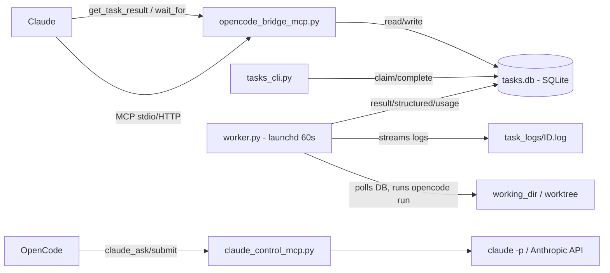

# TaskBridge

> **Claude plans. OpenCode builds.** Dispatch real coding work from Claude to headless OpenCode agents via a durable SQLite queue.

Claude submits tasks over MCP. An auto-worker picks them up in ~60 s, runs `opencode run` in an isolated worktree, and returns a structured summary, git-aware diff, logs, and usage for Claude to read. Works from Claude Desktop (stdio), any MCP client over HTTP, and in reverse — OpenCode can drive Claude too.

    

## Why this exists

Claude is a powerful planner that can't touch your filesystem. OpenCode runs code locally but lives outside Claude's context. The bridge closes the loop:

- **Claude stays the interface** — breaks work down, delegates, and reads results.
- **OpenCode does the execution** — edits, tests, shell, headlessly and reproducibly.
- **SQLite is the durable handoff** — survives restarts, supports retries, priorities, dependencies, and two-way questions.

## Features

- **16 MCP tools for Claude** — `submit_task`, `submit_batch` (up to 20), `get_task` / `get_task_result`, `get_task_logs` (live tail), `wait_for`, `answer_task`, `list_tasks`, `queue_status` / `worker_heartbeat`, `add_task_note`, `cancel_task` / `clear_finished`, `list_models` / `set_default_model`, `ping`. No polling loops, full observability.
- **Headless auto-worker** (`worker.py`) — launchd polls every 60 s, claims oldest-first by priority, streams output to `task_logs/<id>.log`, returns structured `{summary, files_touched, tests_run, open_questions}` plus a git-aware diff.
- **Two-way questions** — worker can pause with a `question` block → task goes `waiting` + macOS banner → Claude answers via `answer_task` → run resumes with the answer in context.
- **Worktree isolation** — per-task branch + `git worktree`, auto-committed on success, cleaned up unless `worktree_keep`.
- **Honest permissions** — `readonly` reverts writes and reports `reverted` files; `no-network` / `no-shell` are prompt-level and explicitly labeled.
- **Reverse bridge** (`claude_control_mcp.py`) — 6 tools for OpenCode to drive Claude: `claude_ask` (sync), `claude_submit` / `claude_poll` / `claude_result` / `claude_cancel` (background), `claude_status`. Uses Anthropic API if `ANTHROPIC_API_KEY` is set, else `claude -p`.
- **Public-URL mode** (`install.sh` / `start_public.sh`) — one command to expose MCP via ngrok (the installer prompts for your Authtoken) or Cloudflare quick tunnel with automatic `MCP_ALLOWED_HOSTS` pairing.
- **Live dispatch board** (`bridge_dashboard.html`) — served at `GET /` on the same host. Tally counts, per-task live logs, reverse jobs, engine tail, and a scrolling feed of fresh output. Polls `/api/*`; MCP stays at `/mcp`.
- **Caller detection** — `submit_task`/`submit_batch` stamp the true caller from the MCP handshake `clientInfo`, so Claude and ChatGPT dockets stay separate. `origin` can be overridden explicitly.
- **Production reliability** — per-attempt timeouts, 15-min stale-`running` reaper with pid-reuse guard, single-instance flock, heartbeat file, macOS banners (`WORKER_NOTIFY=0` to silence).

## Quickstart

Prerequisites: Python 3.12, `opencode` CLI on `PATH`, and (for public access) a free ngrok account.

**One command — install, tunnel, serve, print your connector box:**

```bash
git clone https://github.com/Parithosh-Varma/TaskBridge.git
cd TaskBridge
./install.sh
```

`install.sh` prompts for your ngrok Authtoken (blank = already configured), installs dependencies into `.venv`, generates or reuses the bearer token in `.bridge-token`, opens the ngrok tunnel (fixed domain from `.ngrok-domain` when present), pairs `MCP_ALLOWED_HOSTS`, prints the public URL + token box, then serves MCP in the foreground. Ctrl+C stops the server; the tunnel stays up for the next run. Rotate the token with `./install.sh --rotate`.

**Manual setup** (stdio / local dev):

```bash
git clone https://github.com/Parithosh-Varma/TaskBridge.git
cd TaskBridge
python3.12 -m venv .venv
./.venv/bin/pip install -r requirements.txt
```

Run the MCP server (stdio — Claude Desktop spawns this):

```bash
./.venv/bin/python opencode_bridge_mcp.py
```

Or serve HTTP locally:

```bash
./.venv/bin/python opencode_bridge_mcp.py --transport streamable-http --port 8000
# → http://127.0.0.1:8000/mcp
```

Wire into Claude Desktop — merge `claude_desktop_config.snippet.json` into
`~/Library/Application Support/Claude/claude_desktop_config.json` under `mcpServers`
(replace `<REPO_PATH>` with your checkout path), then restart Claude Desktop.
Verify: ask Claude to list MCP tools — you should see `submit_task`, `get_task`, `list_tasks` under `taskbridge`.

## Authentication (HTTP mode)

`install.sh` generates the bearer token and serves the public endpoint:

```bash
./install.sh            # reuse or generate .bridge-token, tunnel + serve
./install.sh --rotate   # regenerate the bearer token first
```

Token is loaded from `.bridge-token` file or `BRIDGE_AUTH_TOKEN` env var.
`install.sh` and `start_public.sh` (the background / Cloudflare-tunnel variant) both pick it up automatically.

**Public URL access requires**:
```
Authorization: Bearer <your-token>
```

- `/health` is open (monitoring)
- `/` dashboard prompts for token (stored in sessionStorage)
- `/api/*` and `/mcp` require Bearer token
- stdio transport (Claude Desktop) is local-only, no token needed

To rotate token: `./install.sh --rotate`

Run one worker pass manually:

```bash
./.venv/bin/python worker.py
```

Or schedule it every 60s with launchd (macOS) — see `worker.py` header and adjust the plist `ProgramArguments` to your checkout path.

## Usage

From Claude:

1. `submit_task(title="Add retry tests", instructions="Steps..., paths..., acceptance criteria...", working_dir="/path/to/target-repo")` → returns `id`
2. `wait_for(task_ids=["<id>"], timeout_sec=120)` — blocks instead of polling
3. `get_task_result(task_id="<id>")` → `result`, `structured`, `usage`, `diff`

Batch + follow-ups:

- `submit_batch(tasks=[...])` — up to 20 tasks with per-item `model`, `depends_on`, `priority`, `timeout_sec`, `max_retries` / `retry_model`, `tags`, `idempotency_key`, `permission`, `worktree_*`
- `get_task_logs(task_id="...", since_offset=0)` — tail live output
- `answer_task(task_id="...", answer="...")` — answer a `waiting` task's question
- `queue_status()` / `worker_heartbeat()` — queue counts + daemon liveness

From OpenCode (manual worker loop):

```bash
./.venv/bin/python tasks_cli.py pending
./.venv/bin/python tasks_cli.py show <id>
./.venv/bin/python tasks_cli.py claim <id>
# ... do the work (edits, shell, tests) ...
./.venv/bin/python tasks_cli.py complete <id> --result "..."
./.venv/bin/python tasks_cli.py fail <id> --error "..."
```

Reverse (OpenCode → Claude) via `claude_control_mcp.py` (registered as an OpenCode MCP server): `claude_ask` for one-shot answers, `claude_submit` + `claude_poll` / `claude_result` for background jobs.

## How it works



Key components:

| File | Role |
|---|---|
| `opencode_bridge_mcp.py` | MCP server (Claude side), stdio + `streamable-http` / `sse`, host allowlist |
| `task_store.py` | Shared SQLite logic: submit/claim/complete, retries, deps, notes, heartbeat |
| `tasks_cli.py` | CLI for manual runs: `pending list show claim complete fail logs heartbeat answer` |
| `worker.py` | Headless executor: `opencode run --auto`, timeouts, reaper, worktrees, banners |
| `claude_control_mcp.py` | Reverse MCP server (OpenCode → Claude) |
| `install.sh` | One command: deps + bearer token + ngrok tunnel + allowlist + serve |
| `start_public.sh` | Background variant: tunnel + allowlisted MCP server (ngrok fixed domain or Cloudflare) |
| `claude_desktop_config.snippet.json` | Claude Desktop wiring template (`<REPO_PATH>` placeholder) |

## Configuration

| Variable | Used by | Purpose |
|---|---|---|
| `TASK_DB_PATH` | bridge, CLI | SQLite path (default: `<repo>/tasks.db`) |
| `WORKER_MODEL` | worker | Default model, e.g. `opencode/cat-jam-free` |
| `OPENCODE_BIN` | worker | `opencode` binary (default: `opencode` on `PATH`) |
| `WORKER_NOTIFY` | worker | `1` (default) macOS banners, `0` to silence |
| `MCP_ALLOWED_HOSTS` | bridge (HTTP) | Comma-separated tunnel hosts (required behind ngrok/cloudflared, else 421) |
| `BRIDGE_AUTH_TOKEN` | bridge (HTTP) | Bearer token for MCP/API access (defaults to `.bridge-token` file) |
| `TASKBRIDGE_CONSENT_SECRET` | OAuth consent | Secret for the /approve "this was me" page (defaults to the bridge token) |
| `TASKBRIDGE_TOKEN_TTL_SEC` | OAuth | Access-token lifetime (default 86400 = 24h) |
| `TASKBRIDGE_REFRESH_TTL_SEC` | OAuth | Refresh-token lifetime (default 2592000 = 30d) |
| `MCP_PUBLIC_URL` | bridge (HTTP) | Force the public origin in OAuth documents when behind unusual proxies |
| `ANTHROPIC_API_KEY` | reverse bridge | Direct API backend; else `claude -p` CLI |
| `CLAUDE_API_MODEL` / `CLAUDE_MCP_HOME` | reverse bridge | Model override / shadow HOME for CLI backend |

`start_public.sh`: uses `.ngrok-domain` if present (fixed domain), else Cloudflare quick tunnel. It re-pairs `MCP_ALLOWED_HOSTS` automatically — rerun it whenever the URL changes. If `.bridge-token` exists, `BRIDGE_AUTH_TOKEN` is loaded automatically. `install.sh` is the interactive equivalent — it prompts for the ngrok Authtoken and serves MCP in the foreground.

## Project structure

```
.
├── opencode_bridge_mcp.py          # MCP server (Claude → queue)
├── task_store.py                   # SQLite queue logic
├── tasks_cli.py                    # Manual worker CLI
├── worker.py                       # Auto-worker (launchd, 60s)
├── claude_control_mcp.py           # Reverse bridge (OpenCode → Claude)
├── install.sh                      # One-command installer: deps, token, tunnel, serve
├── start_public.sh                 # Public tunnel + server launcher (background)
├── claude_desktop_config.snippet.json
├── claude-clean.settings.json
├── requirements.txt                # mcp>=1.0,<2
└── .gitignore                      # excludes .venv/, tasks.db, logs, task_logs/, claude_jobs/, worktrees/
```

Runtime state (never committed): `tasks.db`, `task_logs/`, `claude_jobs/`, `worktrees/`, `*.log`, `heartbeat.json`.

## Troubleshooting / FAQ

- **421 behind tunnel**: `MCP_ALLOWED_HOSTS` must exactly match the tunnel host. Run `./install.sh` or `./start_public.sh` — they set this automatically.
- **Tunnel URL changed (Cloudflare)**: quick-tunnel hostnames rotate every restart. Rerun `./install.sh` (or `./start_public.sh`), or reserve an ngrok fixed domain via `.ngrok-domain`.
- **Worker looks stuck**: check `./.venv/bin/python tasks_cli.py heartbeat` and `task_logs/<id>.log`. Stale `running` tasks are reaped after 15 min (per-task `timeout_sec` + slack honored).
- **Double-run after kill**: every attempt spawns `opencode run --standalone --title br-<id>-a<n>` (per-attempt argv marker, ps-visible). The reaper kills the orphaned CLI child **plus its ppid tree** (loop-until-empty, hard-capped so a matching bug can't mass-kill); a per-pass sweep catches tagged strays of non-running tasks. Reaper deadline is per-task (`max(900s, timeout_sec + 120s)`). macOS gives no session/env signal (`ps sess=` is 0 everywhere, `ps -E` shows no env), so ppid walk + argv marker are the whole toolkit — reparented-to-1/setsid grandchildren are the known residual. NOTE: never pass `--session` to the CLI: it makes free-tier models refuse to run.
- **No banners**: macOS only. Set `WORKER_NOTIFY=0` to silence intentionally; full output is always in `tasks.db` + `worker.log`.
- **Reverse bridge fails fast (~1s)**: run `claude login` once or set `ANTHROPIC_API_KEY`.
- **`opencode` not found**: put it on `PATH` or set `OPENCODE_BIN=/path/to/opencode`.

## Limitations

- Token counts aren't exposed by the `opencode` CLI — `usage` reports model, latency, attempts, and sandbox status, not tokens.
- `no-network` / `no-shell` are prompt-level restrictions, not OS-enforced sandboxes (documented in `worker.py`).
- Desktop banners and launchd scheduling are macOS-specific; Linux needs its own scheduler (systemd/cron) + `worker.py` still runs manually.
- Long tasks (up to 1800s `timeout_sec`) are supported, but the 60s launchd cadence means pickup latency averages ~30s.

## Verified

- `task_store` submit → claim → complete round-trip: OK
- MCP `submit_task` / `get_task` / `list_tasks` via `call_tool`: OK
- CLI `pending` / `show` / `claim` / `complete`: OK
- `submit_task` → auto-picked-up in ~60s → `get_task_result` with zero manual steps: OK

## License

Apache-2.0 — see [LICENSE](LICENSE). Fork it, self-host it, build on it.
